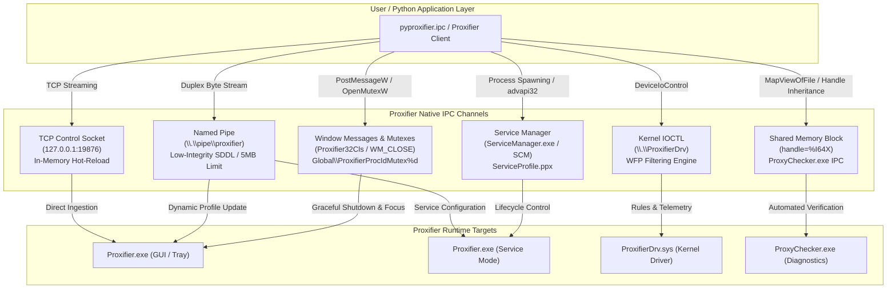

# Proxifier Undocumented IPC & Internal Protocol Reference

Comprehensive technical specification and reverse-engineering reference for all undocumented Inter-Process Communication (IPC) mechanisms, hidden command-line flags, kernel driver interfaces, shared memory protocols, and synchronization primitives across the **Proxifier v4** Windows ecosystem.

---

## Table of Contents

1. [Executive Summary & Reverse Engineering Scope](#1-executive-summary--reverse-engineering-scope)
2. [Global IPC Architecture](#2-global-ipc-architecture)
3. [Native TCP Control Socket API (`control-socket`)](#3-native-tcp-control-socket-api-control-socket)
   - [Activation & Startup](#activation--startup)
   - [Wire Protocol Framing](#wire-protocol-framing)
   - [Command Specification & Response Codes](#command-specification--response-codes)
   - [Binary Offsets & Implementation Details](#binary-offsets--implementation-details)
4. [Named Pipe IPC (`\\.\pipe\proxifier`)](#4-named-pipe-ipc-pipeproxifier)
   - [Pipe Topology & Security Descriptors (SDDL)](#pipe-topology--security-descriptors-sddl)
   - [Payload Format & 5 MB Hard Boundary](#payload-format--5-mb-hard-boundary)
   - [Concurrency, `ERROR_PIPE_BUSY`, & Chunking](#concurrency-error_pipe_busy--chunking)
5. [Kernel Mutex Hierarchy & Process Identity Verification](#5-kernel-mutex-hierarchy--process-identity-verification)
   - [Mutex Registry](#mutex-registry)
   - [Per-Process Mutex & Deterministic PID Resolution](#per-process-mutex--deterministic-pid-resolution)
6. [Window Message IPC & GUI State Automation](#6-window-message-ipc--gui-state-automation)
   - [Window Classes & Titles](#window-classes--titles)
   - [Win32 Messages & Automation Semantics](#win32-messages--automation-semantics)
   - [Headless Tray Mode (`aut` Switch)](#headless-tray-mode-aut-switch)
7. [Direct Kernel WFP Driver IPC (`\\.\ProxifierDrv`)](#7-direct-kernel-wfp-driver-ipc-proxifierdrv)
   - [Device Object & Security Boundaries](#device-object--security-boundaries)
   - [Un-Elevated Presence Probing](#un-elevated-presence-probing)
   - [Administrative IOCTL Dispatch](#administrative-ioctl-dispatch)
8. [Windows Service IPC & `ServiceManager.exe`](#8-windows-service-ipc--servicemanagerexe)
   - [Command-Line Parameters](#command-line-parameters)
   - [Service Profile Resolution (`ServiceProfile.ppx`)](#service-profile-resolution-serviceprofileppx)
   - [SCM API Integration & 64-Bit Handle Management](#scm-api-integration--64-bit-handle-management)
9. [Standalone ProxyChecker Shared Memory IPC](#9-standalone-proxychecker-shared-memory-ipc)
   - [Invocation Syntax (`handle=%I64X`)](#invocation-syntax-handlei64x)
   - [Shared Memory Parameter Block Specification](#shared-memory-parameter-block-specification)
10. [Comprehensive Undocumented CLI Matrix](#10-comprehensive-undocumented-cli-matrix)
11. [64-Bit Windows ctypes Engineering & Safety Rules](#11-64-bit-windows-ctypes-engineering--safety-rules)
12. [Python Mapping (`pyproxifier.ipc`)](#12-python-mapping-pyproxifieripc)

---

## 1. Executive Summary & Reverse Engineering Scope

Official Proxifier documentation (https://www.proxifier.com/docs/win-v4/) documents only the standard graphical user interface and a single command-line option (`silent-load`). However, Proxifier contains an extensive, highly engineered suite of undocumented native IPC endpoints that allow **100% programmatic control, zero-restart profile hot-reloading in memory, telemetry extraction, and automated service management**.

This document is compiled from static binary analysis (PE section parsing, string extraction, disassembly analysis) and runtime behavioral verification on Windows 10/11 x64 systems against:
- `Proxifier.exe` (v4.x x64)
- `ServiceManager.exe` (v4.x x64)
- `ProxyChecker.exe` (v1.57+ x64)
- `ProxifierDrv.sys` (Kernel WFP callout driver)

---

## 2. Global IPC Architecture



---

## 3. Native TCP Control Socket API (`control-socket`)

### Activation & Startup

Proxifier embeds an undocumented, high-performance TCP socket server that allows programmatic remote control without displaying UI prompts or requiring elevated administrator privileges.

To launch Proxifier in Control Socket mode:
```powershell
"C:\Program Files (x86)\Proxifier\Proxifier.exe" control-socket 19876
```
- **Host**: `127.0.0.1` (Bound exclusively to localhost loopback for security).
- **Default Port**: `19876` (Any valid non-privileged port `1024..65535` is accepted).
- **Validation**: If an invalid port string is passed, Proxifier logs: `Incorrect port number for control socket mode.` (Offset `0x36DE90`).

### Wire Protocol Framing

The Control Socket uses a text-delimited request/response framing protocol:

#### 1. Request Format
```
<command_name> <body_length>\r\n<body_bytes>
```
- `<command_name>`: ASCII command string (case-sensitive).
- `<body_length>`: ASCII decimal integer indicating the exact size in bytes of `<body_bytes>` (`0` if no body).
- `\r\n`: Carriage return and line feed delimiter (`0x0D 0x0A`).
- `<body_bytes>`: Raw byte payload.

#### 2. Success Response Format
```
OK <body_length>\r\n<body_bytes>
```
- If `<body_length>` is `0`, the response is terminated immediately after `\r\n`.

#### 3. Error Response Format
```
ERROR <error_code> <error_message>\r\n
```
- `<error_code>`: Optional status or numeric code.
- `<error_message>`: Descriptive error message text.

### Command Specification & Response Codes

| Command Name | Body Format | Response Body | Description |
| :--- | :--- | :--- | :--- |
| **`get_version`** | `b""` (len = 0) | Version string (e.g. `1000`) | Queries Proxifier internal engine version. |
| **`load_config`** | XML Profile Bytes (UTF-8) | `b""` (len = 0) | **Zero-restart hot-reload**. Ingests the XML profile directly into memory, applies routing rules and proxy lists instantly, and updates kernel filters without restarting. |
| **`load_config_file`** | File path (UTF-8 string) | `b""` (len = 0) | Instructs Proxifier to load and apply a `.ppx` profile file directly from the filesystem. |
| **`exit`** | `b""` (len = 0) | `b""` (len = 0) | Requests clean, graceful termination of the Proxifier process. |

### Binary Offsets & Implementation Details

- **Command Dispatcher Table**: Located at raw offset `0x35ADD0` in `Proxifier.exe` v4.
- **Switch String**: `control-socket ` located at offset `0x36DE68`.
- **Immediate Disconnect on `exit`**: When `exit` is received, Proxifier may close the TCP socket connection before sending the complete trailing `\r\n` response. Clients must treat an unexpected EOF or connection closure during `exit` as a successful termination.

---

## 4. Named Pipe IPC (`\\.\pipe\proxifier`)

### Pipe Topology & Security Descriptors (SDDL)

Proxifier creates and maintains a global Win32 Named Pipe server:
```
\\.\pipe\proxifier
```

- **API Used**: `CreateNamedPipeW` and `ConnectNamedPipe` in `Proxifier.exe`.
- **Mode**: Byte stream, duplex (`PIPE_ACCESS_DUPLEX | FILE_FLAG_OVERLAPPED`).
- **Security Descriptor (SDDL)**:
  ```
  D:(D;OICI;GA;;;S-1-5-20)(A;OICI;GRGW;;;S-1-1-0) S:(ML;;NW;;;LW)
  ```
  - **`S:(ML;;NW;;;LW)`**: Low Mandatory Integrity Level (`SECURITY_MANDATORY_LOW_RID`). Allows sandboxed processes (e.g. browsers, Low-IL containers) to connect.
  - **`(A;OICI;GRGW;;;S-1-1-0)`**: Discretionary ACL allowing `Everyone` (`S-1-1-0`) Generic Read (`GR`) and Generic Write (`GW`).
  - **`(D;OICI;GA;;;S-1-5-20)`**: Explicit Deny for `Network Service` (`S-1-5-20`).
  - **Cross-Session Capability**: Designed specifically to allow non-elevated desktop sessions (Session 1, 2, ...) to communicate directly with Proxifier running under Session 0 (Windows Service).

### Payload Format & 5 MB Hard Boundary

The named pipe accepts raw `.ppx` XML profile data for memory-based dynamic configuration.
- **Binary Strings**:
  - `Cannot write to \\.\pipe\proxifier` (offset `0x36D4F0`)
  - `File is too big. Size = %d MB (must be <5 MB).` (offset `0x36D488` / `0x36D4C0`)
- **Hard Limit**: Exactly `5,242,880` bytes (5 MB). Payloads equal to or greater than 5 MB are rejected by Proxifier's pipe listener.

### Concurrency, `ERROR_PIPE_BUSY`, & Chunking

1. **Transient Busy States (`ERROR_PIPE_BUSY = 231`)**:
   - If another client is currently connected or performing a handshake, `CreateFileW` returns `INVALID_HANDLE_VALUE` with `GetLastError() == 231`.
   - **Required Behavior**: Call `WaitNamedPipeW(L"\\\\.\\pipe\\proxifier", timeout_ms)` and retry opening the pipe.
2. **Presence Verification**:
   - `WaitNamedPipeW` returns `TRUE` if the pipe exists and is listening. If it returns `0`, checking `GetLastError() in (5, 231)` confirms that the pipe is alive (5 = Access Denied, 231 = Pipe Busy).
3. **Chunked Writes**:
   - Writes larger than 4096 bytes should be written in a loop checking `bytes_written` until `total_written == len(data)`.

---

## 5. Kernel Mutex Hierarchy & Process Identity Verification

Proxifier uses a structured hierarchy of Win32 Kernel Mutex objects in the `Global\` kernel namespace to enforce single-instance semantics, identify process roles, and expose feature flags.

### Mutex Registry

| Mutex Name | Scope / Role | Usage & Semantics |
| :--- | :--- | :--- |
| **`Global\ProxifierRunning`** | Master System Mutex | Created whenever any Proxifier process (GUI, Tray, or Service) is running. Primary non-invasive presence check. |
| **`Global\ProxifierProcIdMutex<PID>`**<br>*(e.g. `Global\ProxifierProcIdMutex12204`)* | Per-PID Identity Mutex | **Authoritative process verification**. Format string: `Global\ProxifierProcIdMutex%d` (offset `0x36D6A0`). Each Proxifier process creates this mutex for its own PID upon startup. |
| **`Global\Proxifier32Mutex1040`** | Primary GUI Mutex | Active when Proxifier v4 desktop GUI application is initialized. |
| **`Global\ProxifierStd300Mutex`** | Legacy Mutex | Maintained for backwards compatibility with Proxifier v3 tooling. |
| **`Global\ProxifierServiceRunning`** | Windows Service Mutex | Active exclusively when running as the background Windows Service (`ServiceManager.exe service-mode`). Located at offset `0x36D660`. |
| **`Global\ProxifierExtraOptionSendDelay`** | Engine Tuning Mutex | Internal flag indicating whether intentional packet send delay is enabled. |

### Per-Process Mutex & Deterministic PID Resolution

Legacy tools inspect process names (e.g. `proc.name() == "Proxifier.exe"`), which is vulnerable to spoofing, process renaming, or false matches.

Proxifier's native per-PID mutex pattern allows **100% deterministic, tamper-proof discovery**:
```python
def is_pid_proxifier(pid: int) -> bool:
    handle = kernel32.OpenMutexW(SYNCHRONIZE, False, f"Global\\ProxifierProcIdMutex{pid}")
    if handle:
        kernel32.CloseHandle(handle)
        return True
    return False
```

---

## 6. Window Message IPC & GUI State Automation

### Window Classes & Titles

Proxifier registers a dedicated Win32 window class:
- **Class Name**: `Proxifier32Cls` (Offset `0x36D710`: `Could not register Proxifier Window class.`)
- **Window Title**: `Proxifier`

### Win32 Messages & Automation Semantics

1. **Graceful Shutdown (`WM_CLOSE = 0x0010`)**:
   - Posting `PostMessageW(hwnd, WM_CLOSE, 0, 0)` invokes Proxifier's internal clean exit routine.
   - Saves active connection statistics, terminates active proxy tunnels cleanly, unloads WFP callout filters, and closes process handles. Avoids dirty termination (`TerminateProcess`).
2. **State Control**:
   - **Restore Window**: `ShowWindow(hwnd, SW_RESTORE)` (9) followed by `SetForegroundWindow(hwnd)`.
   - **Minimize to Tray**: `ShowWindow(hwnd, SW_HIDE)` (0).
3. **Hang Detection**:
   - `IsHungAppWindow(hwnd)`: Authoritatively queries the Windows Desktop Window Manager to determine if Proxifier's GUI message queue is responsive.

### Headless Tray Mode (`aut` Switch)

When launched via the Windows Registry Autostart key (`HKCU\Software\Microsoft\Windows\CurrentVersion\Run`), Proxifier is invoked with:
```powershell
"C:\Program Files (x86)\Proxifier\Proxifier.exe" aut
```
- **Behavior**: Proxifier starts silently, initializes the WFP driver and network engine, creates the tray notification icon, but **does not create top-level visible desktop windows** until the user explicitly clicks the tray icon.
- In this mode, `FindWindowW` may return `NULL`, but the process is fully functional and responsive to **TCP Control Socket**, **Named Pipe**, and **Kernel Mutex** IPC.

---

## 7. Direct Kernel WFP Driver IPC (`\\.\ProxifierDrv`)

### Device Object & Security Boundaries

Proxifier Standard Edition installs a Windows Filtering Platform (WFP) kernel-mode driver:
- **Device Object**: `\\.\ProxifierDrv`
- **Driver Binary**: `%SystemRoot%\System32\drivers\ProxifierDrv.sys`
- **Driver Service Name**: `ProxifierDrv`

### Un-Elevated Presence Probing

Standard non-admin processes cannot issue IOCTLs to `ProxifierDrv`. However, testing existence without administrator elevation is achieved via query-only access:
```python
handle = kernel32.CreateFileW(
    r"\\.\ProxifierDrv",
    0,  # No GENERIC_READ / GENERIC_WRITE needed
    0,
    None,
    OPEN_EXISTING,
    0,
    None,
)
```
- **Driver Not Loaded**: Returns `ERROR_FILE_NOT_FOUND` (2).
- **Driver Active & Running**: Returns `ERROR_ACCESS_DENIED` (5) or `ERROR_SHARING_VIOLATION` (32).

### Administrative IOCTL Dispatch

When elevated as Administrator (`SE_DEBUG_NAME` / elevated token), `CreateFileW` with `GENERIC_READ | GENERIC_WRITE` allows `DeviceIoControl` communication:
- **`SetConfig`**: Transmits routing tables and proxy redirection endpoints directly to the kernel callout filter.
- **`GetStat`**: Queries real-time connection counters and byte transfer statistics directly from the network stack.
- **`SetEngineOptions`**: Toggles loop prevention, DNS interception, and socket redirection flags.

---

## 8. Windows Service IPC & `ServiceManager.exe`

### Command-Line Parameters

Proxifier v4 includes `ServiceManager.exe` for unattended Windows Service management:

| Command | Privileges | Description |
| :--- | :--- | :--- |
| `ServiceManager.exe silent-install` | Administrator | Registers the `Proxifier` Windows Service in Windows Service Control Manager (SCM). |
| `ServiceManager.exe silent-uninstall` | Administrator | Stops and removes the `Proxifier` Windows Service from SCM. |
| `ServiceManager.exe silent-start` | Administrator | Starts the `Proxifier` Windows Service via SCM. |
| `ServiceManager.exe silent-stop` | Administrator | Sends stop control signal to the service. |
| `ServiceManager.exe service-mode` | LocalSystem / Service | Starts the Proxifier engine in headless daemon service mode. |

### Service Profile Resolution (`ServiceProfile.ppx`)

When running in Service Mode, Proxifier does not read user profile directories (`%APPDATA%`). It strictly reads from the system-wide ProgramData directory:
- **Primary Path (v4)**: `%ProgramData%\Proxifier4\Profiles\ServiceProfile.ppx`
- **Fallback Path (v3/legacy)**: `%ProgramData%\Proxifier\Profiles\ServiceProfile.ppx`

### SCM API Integration & 64-Bit Handle Management

Programmatic service querying connects to Windows SCM:
- `advapi32.OpenSCManagerW(None, None, SC_MANAGER_CONNECT)`
- `advapi32.OpenServiceW(scm, "Proxifier", SERVICE_QUERY_STATUS)`
- `advapi32.QueryServiceStatusEx(service, SC_STATUS_PROCESS_INFO, ...)`

---

## 9. Standalone ProxyChecker Shared Memory IPC

### Invocation Syntax (`handle=%I64X`)

When Proxifier executes its integrated diagnostic tool `ProxyChecker.exe`, it avoids writing temporary configuration files or passing plaintext passwords in CLI arguments. Instead, it uses **Windows File Mapping (Shared Memory)**:

```powershell
"C:\Program Files (x86)\Proxifier\ProxyChecker.exe" handle=00000000000001B8
```
- The argument `handle=%I64X` passes an inherited 64-bit Win32 File Mapping handle formatted as an uppercase hexadecimal string (Offset `0x6B710`).

### Shared Memory Parameter Block Specification

The memory block mapped via `MapViewOfFile` contains a structured key-value configuration block:
- **`TargetHost`**: Destination domain or IP for connectivity test.
- **`TargetPort`**: Destination port (e.g. `80`, `443`).
- **`HtmlTest`**: Boolean flag indicating whether to perform HTTP GET verification.
- **`Proxy`**: Proxy server address.
- **`Port`**: Proxy server listening port.
- **`Auth`**: Authentication type (`NO`, `YES`, `USER_ONLY`, `NTLM`, `BASIC`).
- **`User`**: Username credential string.
- **`CurUserAuth`**: Flag to use current Windows logged-in user token (SSO/NTLM).
- **`TestData`**: Verification payload bytes.

`ProxyChecker.exe` reads the parameters, executes the three-stage test (Connection, Tunneling, Latency), and writes execution telemetry back into the shared memory segment before terminating.

---

## 10. Comprehensive Undocumented CLI Matrix

| Executable | Parameter / Switch | Elevated? | Functional Behavior |
| :--- | :--- | :--- | :--- |
| `Proxifier.exe` | `<path> silent-load` | No | Hot-reloads profile into running instance without UI confirmation. |
| `Proxifier.exe` | `<path> convert-and-quit` | No | Migrates legacy `.prx` format profile to current schema and exits. |
| `Proxifier.exe` | `control-socket <port>` | No | Starts native TCP Control Socket API server on specified port. |
| `Proxifier.exe` | `service-mode` | Yes (Service) | Executes engine in headless Windows Service mode. |
| `Proxifier.exe` | `register <license_key>` | No / Yes | Registers product license key directly from command line. |
| `Proxifier.exe` | `aut` | No | Autostart mode: runs silently in system tray without opening window. |
| `ServiceManager.exe` | `silent-install` | Yes | Installs `Proxifier` Windows Service into SCM. |
| `ServiceManager.exe` | `silent-uninstall` | Yes | Removes `Proxifier` Windows Service from SCM. |
| `ServiceManager.exe` | `silent-start` | Yes | Starts `Proxifier` Windows Service via SCM. |
| `ServiceManager.exe` | `silent-stop` | Yes | Stops `Proxifier` Windows Service via SCM. |
| `ProxyChecker.exe` | `handle=%I64X` | No | Runs automated test via inherited shared memory handle. |

---

## 11. 64-Bit Windows ctypes Engineering & Safety Rules

Interfacing with Windows Win32 APIs via Python `ctypes` on 64-bit systems carries severe edge cases that cause silent handle corruption, crashes, or memory leaks:

### 1. Pointer Truncation Trap
By default, `ctypes.windll` assigns `restype = ctypes.c_long` (signed 32-bit int) to all functions.
- On Win64, pointer handles (`HANDLE`, `HWND`, `SC_HANDLE`) are 64 bits wide.
- If a handle address exceeds `0x7FFFFFFF` (e.g. `0x237058581f0`), ctypes truncates it to 32 bits and sign-extends to `0xffffffffa37651b0`.
- Passing the truncated value to `CloseHandle` or `CloseServiceHandle` fails with `ERROR_INVALID_HANDLE (6)`, leaking kernel handles.
- **Rule**: Every Win32 function returning or receiving handles must explicitly declare `restype = wintypes.HANDLE` or `wintypes.HWND` and define `argtypes`.

### 2. Universal Handle Validation (`is_invalid_handle`)
In Windows, invalid handles take two forms depending on the API:
- `NULL` (`0` or `None`)
- `INVALID_HANDLE_VALUE` (`(HANDLE)-1` or `0xFFFFFFFFFFFFFFFF` unsigned)

```python
def is_invalid_handle(handle: int | None | object) -> bool:
    if handle is None:
        return True
    if isinstance(handle, int):
        return handle in (0, -1, 0xFFFFFFFF, 0xFFFFFFFFFFFFFFFF)
    val = getattr(handle, "value", "NOT_FOUND")
    if val is None:
        return True
    if isinstance(val, int):
        return val in (0, -1, 0xFFFFFFFF, 0xFFFFFFFFFFFFFFFF)
    return False
```

---

## 12. Python Mapping (`pyproxifier.ipc`)

The reverse-engineered IPC mechanisms are mapped into high-level Python abstractions within `pyproxifier`:

| Undocumented IPC Mechanism | Python Class / Module | Primary API Methods |
| :--- | :--- | :--- |
| **Native TCP Control Socket** | `pyproxifier.ipc.ControlSocketClient` | `start_and_connect()`, `load_config()`, `get_version()`, `exit()` |
| **Named Pipe IPC** | `pyproxifier.ipc.NamedPipeClient` | `connect()`, `send_profile()`, `transact()`, `is_pipe_available()` |
| **Per-PID & Global Mutexes** | `pyproxifier.ipc.WindowIPC` | `is_instance_running()`, `is_pid_proxifier()`, `find_proxifier_pids()` |
| **Window Message IPC** | `pyproxifier.ipc.WindowIPC` | `find_window()`, `post_close_message()`, `bring_to_front()`, `minimize_to_tray()` |
| **Kernel WFP Driver** | `pyproxifier.ipc.DriverIPC` | `is_device_present()`, `open()`, `ioctl()` |
| **Windows Service Automation** | `pyproxifier.ipc.ServiceIPC` | `install()`, `uninstall()`, `start()`, `stop()`, `deploy_service_profile()` |
| **Unified IPC Controller** | `pyproxifier.ipc.IPCManager` | `apply_profile()`, `graceful_exit()`, `is_proxifier_running()` |

### Code Example: Zero-Restart Dynamic Profile Hot-Reload

```python
from pyproxifier import Proxifier, ProxyProtocol, ActionType

# 1. Initialize client facade
prox = Proxifier()

# 2. Add high-speed proxy and define browser rule
proxy = prox.proxies.add("198.51.100.1", 1080, ProxyProtocol.SOCKS5, label="HighSpeed")
prox.rules.add("Browsers", applications="chrome.exe; firefox.exe", action=ActionType.PROXY, target_id=proxy.id)

# 3. Apply profile dynamically via IPC (Zero restarts, zero disk writes)
# Automatically selects: TCP Control Socket -> Named Pipe -> silent-load
success = prox.apply()
print(f"Profile applied via native IPC: {success}")
```

