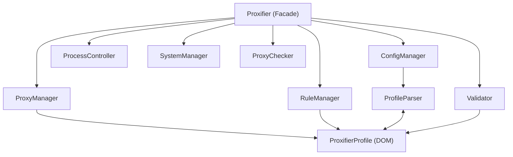

# pyproxifier Architecture and Design Reference

This document details the internal design, component relationships, data flow, and design patterns utilized in `pyproxifier`.

---

## 1. Architectural Philosophy

`pyproxifier` is structured around four primary design principles:

1. **Separation of Concerns**: High-level proxy and routing business logic is separated from low-level XML DOM representation and OS process primitives.
2. **Fail-Fast Validation**: Pre-flight validation ensures corrupted, dangling, or illegal rules cannot be passed to Proxifier.
3. **Non-Blocking Automation**: Background process execution handles Proxifier's GUI lifecycle without deadlocking on stdout/stderr IPC pipes.
4. **100% Strict Type Safety**: Designed from the ground up for modern Python 3.10+ with full `basedpyright` and `mypy` strict compatibility.

---

## 2. Component Diagram



---

## 3. Core Modules and Responsibilities

### 3.1. Facade Layer: `Proxifier` (`pyproxifier/client.py`)
- Single point of entry for user code.
- Holds the in-memory active `ProxifierProfile`.
- Exposes convenience shortcuts (`add_proxy`, `add_rule`, `set_direct_mode`, `set_lockdown_mode`).
- Coordinates `validate()`, `save()`, and `apply(silent=True)`.

### 3.2. Managers Layer (`pyproxifier/managers/`)
- **`ProxyManager`**:
  - Handles CRUD for proxy servers.
  - Automatically manages unique IDs (starting from 100).
  - Handles proxy chains (`simple`, `redundancy`, `load_balancing`).
  - Safe deletion: prevents deleting proxies referenced by active rules unless `force=True` (in which case it automatically re-routes referencing rules to `Direct`).
- **`RuleManager`**:
  - Handles routing rules ordered by evaluation priority.
  - Controls insertion points (`before`, `after`, and default insertion before the mandatory `Default` rule).
  - Protects the system `Default` rule from illegal reordering or deletion.
- **`ConfigManager`**:
  - Loads and saves `.ppx` files.
  - Discovers profile folders (`%APPDATA%\Proxifier4\Profiles`).
  - Provides factory methods for baseline templates (`new_default`, `new_direct`, `new_lockdown`).

### 3.3. Document Object Model Layer (`pyproxifier/models/`)
- Pure Python dataclasses representing profile elements:
  - `ProxyItem`: proxy server definition.
  - `ChainItem`: proxy chain definition.
  - `RuleItem`: routing rule with canonical action casing.
  - `ProfileOptions`: global Proxifier flags (DNS fake IP pool, UDP routing, loop detection, leak prevention).
  - `ProxifierProfile`: root document container.

### 3.4. Serialization Layer: `ProfileParser` (`pyproxifier/parser.py`)
- Bidirectional XML translation (`from_xml` and `to_xml`).
- Formats XML with tabs matching Proxifier's native file generator.
- Preserves credentials and explicit authentication toggles.

### 3.5. Validation Layer: `Validator` (`pyproxifier/validator.py`)
- Port bounds validation (`1..65535` and valid ranges `start <= end`).
- Target token validation (IPv4, IPv6, bracketed IPv6 `[::1]`, CIDR blocks, wildcard hostnames, environment variables `%...%`).
- Referential integrity verification:
  - Rules with `Action=Proxy` must reference existing proxy IDs.
  - Rules with `Action=Chain` must reference existing chain IDs.
  - Chains must reference existing proxy IDs.
  - Mandatory presence and final position of the `Default` rule.

### 3.6. Operating System & Process Layer
- **`ProcessController` (`pyproxifier/process.py`)**:
  - Windows registry and standard Program Files discovery.
  - Non-blocking `silent-load` execution via `subprocess.Popen(..., stdout=DEVNULL, stderr=DEVNULL)` to avoid pipe deadlocks with Windows GUI processes.
- **`SystemManager` (`pyproxifier/system.py`)**:
  - Windows Registry license management (`HKCU` and `HKLM\Software\Initex\Proxifier\License`).
  - Network driver control (`sc.exe query ProxifierDrv`, `net start/stop ProxifierDrv`).
  - Global `Default.ppx` deployment (`%ProgramData%\Proxifier\Default.ppx`).
- **`ProxyChecker` (`pyproxifier/checker.py`)**:
  - Asynchronous TCP socket testing.
  - SOCKS5 protocol authentication and handshake verification.
  - Concurrent batch testing with concurrency limits.
  - Wrapper for standalone `ProxyChecker.exe`.

---

## 4. Exception Design

Single-inheritance tree deriving from `ProxifierError`:

```
ProxifierError
├── ProfileError (ProfileNotFoundError, ProfileParseError, ProfileCorruptedError)
├── ValidationError (InvalidPortError, InvalidAddressError, ProxyReferenceNotFoundError, ChainReferenceNotFoundError, RuleConfigurationError)
├── EntityNotFoundError (ProxyNotFoundError, ChainNotFoundError, RuleNotFoundError)
└── ProcessError (ProxifierNotFoundError, DriverError, RegistryAccessError)
```

